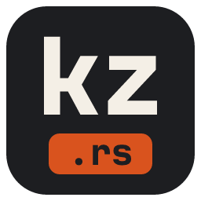

  
  <h1>KZRS</h1>

  

    
    
    
    
    
  

  

    
    
  

KZRS adalah penerjemah manga dan komik untuk desktop, dibuat dengan Rust. KZRS menemukan balon
dialog dan teks bebas di halaman dengan AI di perangkat, menerjemahkannya dengan penyedia LLM
pilihanmu (atau yang lokal seperti Ollama atau LM Studio), menghapus tulisan aslinya, lalu
menata terjemahannya kembali di halaman. Ada editor halaman, pembaca, dan ekspor CBZ/PDF.

Repositori ini berisi **rilis** dan catatan perubahan; kode sumbernya privat.

---

## Unduh

Ambil versi terbaru di **[Releases](https://github.com/kouzen-neo/kzrs/releases/latest)**.

| Sistem | File | Cara pasang |
|---|---|---|
| Windows 10/11 (64-bit) | `KZRS-Setup-<versi>-x64.exe` | Jalankan dan ikuti langkahnya. `KZRS-<versi>-x64.msi` adalah aplikasi yang sama untuk IT / PC kantor. |
| macOS 11+ (Apple Silicon) | `KZRS-<versi>-macos-arm64.dmg` | Buka lalu seret **KZRS** ke **Applications**. |
| Linux x86_64 | `KZRS-<versi>-x86_64.AppImage` | Jadikan executable (`chmod +x`, atau Properties → Allow executing) lalu buka. Ada juga `.tar.gz` dengan `install.sh` untuk menu aplikasi. |

Aplikasinya belum ditandatangani (code signing), jadi sistem akan bertanya sekali:

- **Windows**: "Windows protected your PC" → **More info** → **Run anyway**.
- **macOS**: buka KZRS sekali, lalu **System Settings → Privacy & Security → Open Anyway**.
- **Linux AppImage**: kalau tidak mau jalan, pasang `libfuse2`, atau jalankan dengan `--appimage-extract-and-run`.

Model OCR dan LaMa (opsional) diunduh dari dalam aplikasi (Settings > Storage).

---

## Fitur utama

- **Banyak format masukan**: gambar, folder, ZIP / CBZ, EPUB dan PDF.
- **Vision lokal**: deteksi balon, OCR, inpainting dan penataan teks berjalan di komputermu; yang
  dikirim ke penyedia terjemahan hanya teks balonnya, gambarnya tidak pernah.
- **LLM apa saja**: Google Gemini, Anthropic Claude, OpenAI, OpenRouter, Zen, OpenCode Go, atau
  endpoint yang kompatibel dengan OpenAI (Ollama, LM Studio, vLLM...).
- **Hasil rapi**: inpainting LaMa / Telea, pemenggalan baris sesuai balon, teks Jepang vertikal,
  font komik bawaan dan preset gaya.
- **Editor halaman**: geser, ubah ukuran dan gaya kotak, kuas / restore / hapus, gambar dan
  layer, edit massal, undo per halaman.
- **Pembaca dan ekspor**: mode halaman atau webtoon, ekspor ke CBZ atau PDF.
- **Agen AI (Supporter)**: server MCP dan CLI, supaya Claude Code, OpenCode atau Codex bisa
  memeriksa dan memperbaiki halaman untukmu.

---

## Gratis dan Supporter

KZRS gratis dengan **10 halaman terjemahan per hari**. Editor, pembaca dan ekspor tidak dibatasi.

Kode **Supporter** menghapus batas harian dan membuka command line serta tool agen AI. Satu kode
berlaku di satu komputer selama satu tahun. Untuk mendapatkannya, hubungi pengembang; kodenya
dikirim lewat pesan dan kamu aktifkan sendiri di aplikasi (*Supporter activation*, atau chip di
bilah atas).

---

## Masukan

Bug dan ide: [Issues](https://github.com/kouzen-neo/kzrs/issues).

Perubahan tiap versi: [CHANGELOG.md](CHANGELOG.md).

---

## Lisensi

Freeware proprietary. Hak cipta dilindungi.
