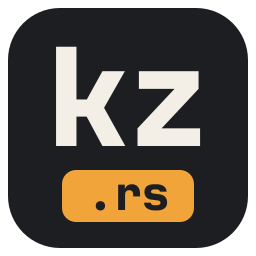
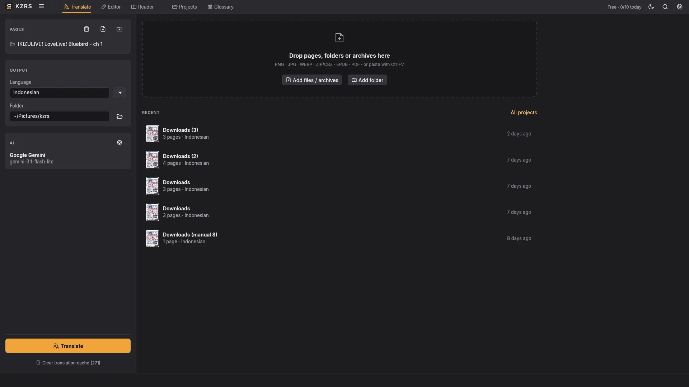
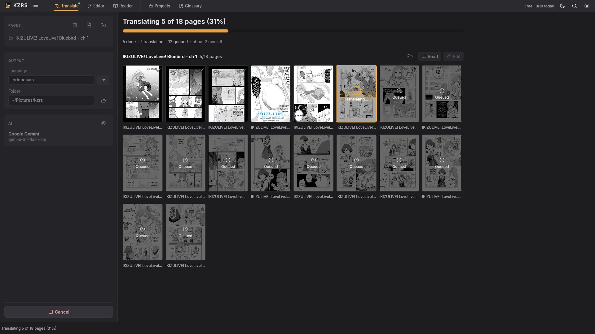
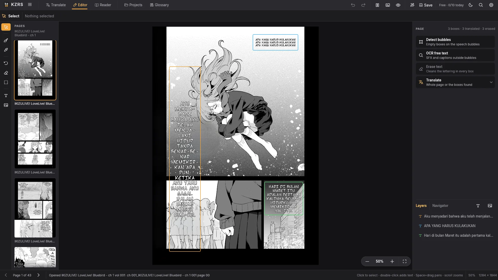
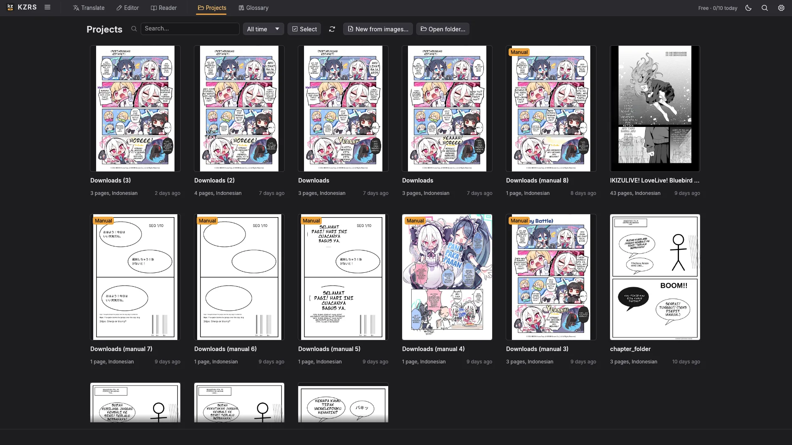
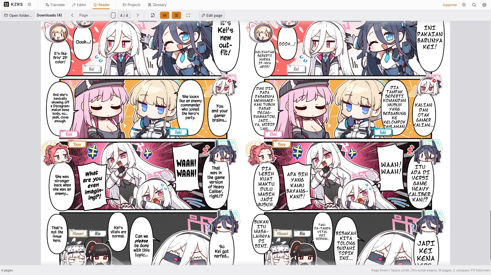
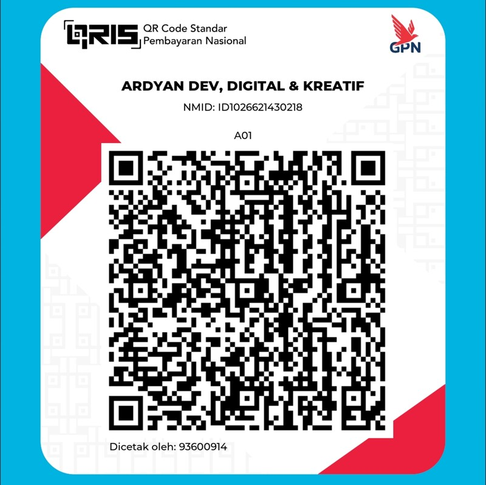

  
  <h1>KZRS</h1>

  

    
    
    
    
    
  

  

    
    
  

KZRS is a desktop manga and comic translator written in Rust. It finds the speech bubbles and
free text on a page with on-device AI, translates them with the LLM provider you choose (or a
local one such as Ollama or LM Studio), erases the original lettering and typesets the
translation back onto the page. A full page editor, a reader and CBZ/PDF export are built in.

This repository hosts the **releases** and the changelog; the source is private.

---

## Download

Get the latest version from **[Releases](https://github.com/kouzen-neo/kzrs/releases/latest)**.

| System | File | How to install |
|---|---|---|
| Windows 10/11 (64-bit) | `KZRS-Setup-<version>-x64.exe` | Run it and follow the steps (no admin needed). `KZRS-<version>-x64.msi` is the same app for IT / company PCs. |
| Linux x86_64 (Ubuntu 24.04, Debian 13, Fedora 39, Mint 22 or newer) | `KZRS-<version>-x86_64.AppImage` | Make it executable (`chmod +x`, or Properties → Allow executing) and open it. A `.tar.gz` with an `install.sh` menu installer is there too. |
| macOS (Apple Silicon) | Coming soon | |

The apps are not code-signed yet, so the system asks once:

- **Windows**: "Windows protected your PC" → **More info** → **Run anyway**.
- **Linux AppImage**: if it does not start, install `libfuse2`, or run it with `--appimage-extract-and-run`.

The optional OCR and LaMa models download from inside the app the first time they are needed
(Settings > Models).

---

## Highlights

- **Many inputs**: images, folders, ZIP / CBZ, EPUB and PDF.
- **Local vision**: bubble detection, OCR, inpainting and typesetting run on your computer; the
  translation provider only gets the cut-out bubbles and text lines (one picture of them per
  request), never your whole pages or files.
- **Any LLM**: Google Gemini, Anthropic Claude, OpenAI, OpenRouter, Zen, OpenCode Go, or any
  OpenAI-compatible endpoint (Ollama, LM Studio, vLLM...).
- **Clean results**: LaMa / Telea inpainting, bubble-aware line breaking, vertical Japanese,
  bundled comic fonts and style presets.
- **Page editor**: move, resize and restyle boxes, brush / restore / erase tools, pictures and
  layers, batch edits, undo per page.
- **Reader and export**: page or webtoon reading, export to CBZ or PDF.
- **AI agents (Supporter)**: an MCP server and a CLI, so Claude Code, OpenCode or Codex can
  check and fix pages for you.

---

## Screenshots

Translate: drop pages, pick a language and an AI, press Translate.

Each page shows how far it is while the chapter translates.

Editor: every bubble is a text box you can retype, restyle or move.

Projects: every run is kept, with its pages, to read, edit or export again.

Reader: page or webtoon mode, the original side by side if you want.

---

## Free and Supporter

KZRS is free with **10 translated pages** and **5 manual (editor-only) pages a day**. Editing,
reading and exporting what you already have are not limited. No account is needed.

A **Supporter** code removes the daily limits and unlocks the command line and the AI agent tools
(MCP) for Claude Code, OpenCode and Codex. A code works on one computer.

| Plan | Price |
|---|---|
| Supporter · 1 year | Rp 20.000 |
| Supporter · 3 years | Rp 50.000 (save Rp 10.000) |

### How to get a code

1. Message **Ardyan** on [Facebook](https://www.facebook.com/share/1FZ2SXJmeL/) and say which plan you
   want: 1 year or 3 years.
2. Pay with **QRIS** (any Indonesian bank or e-wallet app: GoPay, OVO, DANA, ShopeePay, m-banking).
3. Send the payment receipt on Facebook. Your code (`KZRS-XXXX-XXXX-XXXX`) arrives by message.
4. In KZRS, open *Supporter activation* (shown at the first start, or click the chip at the right of
   the top bar), paste the code and press **Activate**.

New computer? Remove the old device in *Supporter activation*, then activate the code on the new one.

  
  
QRIS · ARDYAN DEV, DIGITAL &amp; KREATIF

---

## Feedback

Bugs and ideas: [Issues](https://github.com/kouzen-neo/kzrs/issues), or [Facebook](https://www.facebook.com/share/1FZ2SXJmeL/).

Changes per version: [CHANGELOG.md](CHANGELOG.md).

---

## License

Proprietary freeware. All rights reserved.
